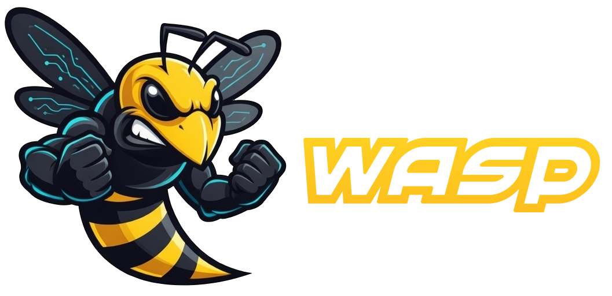

<div align="center">



**A serious agent. Built to evolve.**

Self-hosted autonomous AI agent. Plans, executes, and improves itself running on infrastructure you own.

[](LICENSE.md)
[](CHANGELOG.md)
[](https://docs.agentwasp.com)
[](#install)
[](https://www.python.org)
[](https://docs.docker.com)

[**Website**](https://agentwasp.com) · [**Docs**](https://docs.agentwasp.com) · [**Quick Start**](#install) · [**Architecture**](#architecture) · [**License**](LICENSE.md)

</div>

---

WASP is an **Autonomous Operational Workforce** — a unified digital staff designed to carry out the day-to-day work of real-world employees.

Rather than being a traditional code-generation assistant like Cursor or Claude Code, WASP **operates as a team of autonomous digital employees**. It doesn't write monolithic software from scratch; instead, **it gets real work done by wielding powerful modern tools** — orchestrating Antigravity MCP servers, Claude, Gemini, Google Workspace (Gmail, Drive, Sheets, Photos), browsers, shell environments, and schedulers to accomplish end-to-end deliverables autonomously.

## Install

```bash
sudo bash -c "$(curl -fsSL https://agentwasp.com/install.sh)"
```

That single line:

1. Detects your distro (8 Linux flavors + macOS supported)
2. Installs Docker + compose plugin if missing
3. Pulls the source tarball (clean, 2.1 MB, allowlist-built)
4. Generates secure secrets with `openssl rand`
5. Walks you through onboarding (Telegram, provider keys, dashboard credentials)
6. Builds the containers and starts the stack

Default install path: `/opt/wasp`. Default dashboard: `http://<your-host>:8080`.

### Verify the installer (optional, recommended)

Prefer to inspect the script before piping it into `bash`? Verify the SHA-256 against the published checksum:

```bash
curl -fsSL https://agentwasp.com/install.sh -o install.sh
curl -fsSL https://agentwasp.com/install.sh.sha256 | sha256sum -c -
# install.sh: OK
sudo bash install.sh
```

The Windows installer has the same option: `https://agentwasp.com/install.ps1.sha256`.

### Post-install

```bash
wasp status      # see what's running
wasp logs        # tail logs
wasp health      # run health probes
```

## What WASP Does: True Autonomous Capabilities

WASP transforms autonomous agents into an **operational enterprise staff**. It is built on the principle that the highest-leverage AI work is not syntax typing, but **tool orchestration, verification, common-sense teleology, and real-world execution**.

### 💼 Autonomous Employee Staff & Roles
* **16 Specialized Digital Employees**: Defined across Operations, Architecture, Security, Communications, Research, and Executive Decision-Making (e.g. *Athena* for Fleet Governance, *Ares* for Red-Team Auditing, *Prometheus* as Enclave Broker, *Dr. Albert* for Anti-Hype Scientific Forensics).
* **Cross-Departmental Collaboration**: Agents divide complex briefs, execute consensus reviews, challenge assumptions, and produce verified artifacts.

### 🛠️ Execution Through High-Leverage Tools
WASP doesn't need to hand-code everything because it commands specialized execution engines:
* **Antigravity & MCP Client Ecosystem**: Direct integration with Model Context Protocol (MCP) servers across databases, filesystems, browsers, and cloud runtimes.
* **Multi-Model Orchestration**: Intelligently routes workloads to Claude 3.5, Gemini 2.0/2.5, xAI Grok, or local Ollama models based on task nature, quota budget, and required precision.
* **Communications & Office Suite**: Full autonomous email triage (IMAP/SMTP with malicious-link quarantine), Google Workspace (Drive, Sheets, Photos, Calendar), Telegram, Discord, and Slack bridges.
* **Deterministic Tool Execution**: Sandboxed Python execution, browser automation (nodriver/Selenium), automated REST webhooks, and direct OS bridges (Windows/Linux).

### 🧠 Cognitive Architecture & Common Sense
* **Curiosity & Common-Sense Governance Cockpit**: Enforces mathematical teleological equilibrium ($\Omega_{\text{sense}}$). Suppresses goal drift ($\Delta_{\text{drift}} \le 0.45$) and preserves token budgets before any autonomous task is triggered.
* **Persistent Layered Memory**: Episodic, semantic, procedural, working memory, behavioral rules, knowledge graphs, and a temporal world model.
* **Autonomous Teleological Self-Evolution (ATSE)**: 24/7 background self-evolution daemon grounded in AST codebase entropy ($H_{\text{AST}} = 0.8451$), Triad Adversarial Consensus (Proposer $\to$ Critic $\to$ Judge with Security VETO), and shadow worktree staging with 1.27ms atomic rollback. See [docs/AUTONOMOUS_TELEOLOGICAL_SELF_EVOLUTION.md](docs/AUTONOMOUS_TELEOLOGICAL_SELF_EVOLUTION.md).
* **Truth & Verification Layer**: Prevents hallucinated claims by binding model outputs to actual tool receipts and system logs.

## What WASP Is (and Is Not)

* **An Autonomous Employee Operator**: Designed to execute business tasks, audit systems, handle client messages, manage schedules, and run continuous operations.
* **NOT a Bare Syntax Generator / Code-Typing IDE**: It does not replace code editors like Claude Code or Cursor. When development or maintenance tasks arise, it coordinates developer tooling, reviews diffs, runs tests, and applies verified atomic patches.
* **Self-Hosted & Sovereign**: Runs on your hardware, server, or cloud node without vendor lock-in or multi-tenant surveillance.
* **Safe by Default**: Sandboxed execution, Quota Guard RPM pacing, and human-in-the-loop review for high-impact actions.

## Requirements

- Linux x86_64 (Ubuntu 22.04+ / Debian 12+ recommended) — or macOS / Windows via WSL2.
- 4 GB RAM minimum, 8 GB recommended.
- 10 GB free disk.
- At least one LLM provider key (Anthropic / OpenAI / xAI / Google) — or Ollama for fully self-hosted (slower with small models; see [STATUS_AND_LIMITS.md](docs/STATUS_AND_LIMITS.md)).

## Installer flags

```bash
# Default — tarball method, full stack
sudo bash -c "$(curl -fsSL https://agentwasp.com/install.sh)"

# Use git clone instead of the tarball (for contributors)
curl -fsSL https://agentwasp.com/install.sh -o install.sh && sudo bash install.sh --install-method git

# Stop after Docker is installed (don't start WASP)
curl -fsSL https://agentwasp.com/install.sh -o install.sh && sudo bash install.sh --docker-only

# Install but don't start services (manual control)
curl -fsSL https://agentwasp.com/install.sh -o install.sh && sudo bash install.sh --no-start

# Fully non-interactive (no onboarding wizard)
curl -fsSL https://agentwasp.com/install.sh -o install.sh && sudo bash install.sh --yes
```

## CLI

```
wasp onboard         Re-run the configuration wizard
wasp start           Start the stack
wasp stop            Stop the stack
wasp restart         Restart all services
wasp status          Container status + health checks
wasp logs [service]  Stream logs (default: agent-core)
wasp health          Run the full health probe suite
wasp update          Pull latest tarball, rebuild, restart, verify
wasp backup          Create a timestamped backup archive (Postgres + volumes)
wasp restore <file>  Restore from a backup archive
wasp reset           Wipe runtime state but keep volumes
wasp uninstall       Remove WASP (asks before deleting data)
wasp help            Show command reference
```

## Architecture

```
┌────────────┐                    ┌─────────────────┐
│  Telegram  │ ─── Redis Streams ─┤                 │
└────────────┘                    │   agent-core    │
                                  │  · 41 schedulers│
┌────────────┐                    │  · 37 skills    │
│ Dashboard  │ ─── HTTP/SSE ──────┤  · goal engine  │
│  (browser) │                    │  · truth layer  │
└────────────┘                    │                 │
                                  └────────┬────────┘
                                           │
                              ┌────────────┴────────────┐
                              │                         │
                       ┌──────▼──────┐          ┌──────▼──────┐
                       │  Postgres   │          │    Redis    │
                       │  28 tables  │          │  cache + KV │
                       └─────────────┘          └─────────────┘
```

See [docs.agentwasp.com](https://docs.agentwasp.com) for the full architecture reference.

## Docs

- [docs/INSTALL.md](docs/INSTALL.md) — full install reference, env vars, distro notes
- [docs/QUICKSTART.md](docs/QUICKSTART.md) — first 10 minutes
- [docs/DEPLOYMENT.md](docs/DEPLOYMENT.md) — VPS + local + reverse-proxy guidance
- [docs/SECURITY.md](docs/SECURITY.md) — threat model, fail-closed defaults, secret handling
- [docs/STATUS_AND_LIMITS.md](docs/STATUS_AND_LIMITS.md) — honest map of what works and what's experimental
- [docs/AGENT_MESH_ARCHITECTURE.md](docs/AGENT_MESH_ARCHITECTURE.md) — Grok-style UI/UX and 15-bot Agent Mesh architecture
- [docs/AUTONOMOUS_TELEOLOGICAL_SELF_EVOLUTION.md](docs/AUTONOMOUS_TELEOLOGICAL_SELF_EVOLUTION.md) — 24/7 autonomous employee self-evolution loop, AST Shannon entropy, Common-Sense Gate ($\Omega_{\text{sense}}$), Triad consensus, and shadow staging
- [docs/GOOGLE_WORKSPACE_AND_MESH_GUIDE.md](docs/GOOGLE_WORKSPACE_AND_MESH_GUIDE.md) — Google Workspace OAuth integration guide, Colab/Jules mapping, and kinetic UI telemetry
- [docs/GITHUB_FLEET_AUDIT_SPEC.md](docs/GITHUB_FLEET_AUDIT_SPEC.md) — 4-parameter fleet audit spec, anti-parameters, and Common Sense cognitive heuristics
- [docs/EMPLOYEE_SPEC_GITHUB_FLEET_STEWARD.md](docs/EMPLOYEE_SPEC_GITHUB_FLEET_STEWARD.md) — Athena (Bot 15): GitHub fleet steward, Copilot CLI synergy, code security
- [docs/EMPLOYEE_SPEC_PROMETHEUS_ANTIGRAVITY_BROKER.md](docs/EMPLOYEE_SPEC_PROMETHEUS_ANTIGRAVITY_BROKER.md) — Prometheus: Antigravity capabilities broker, MCP server matrix, unified memory
- [docs/CHARTER_PROMETHEUS_RESPONSIBILITY.md](docs/CHARTER_PROMETHEUS_RESPONSIBILITY.md) — Grand Accountability Charter for god-tier root access
- [docs/EMPLOYEE_SPEC_DR_ALBERT_RESEARCH.md](docs/EMPLOYEE_SPEC_DR_ALBERT_RESEARCH.md) — Dr. Albert (Bot 09): Principal Scientist, 4-tier truth classification, anti-hype filter
- [docs/DR_ALBERT_SCIENTIFIC_WORKBENCH_AND_TOOLS.md](docs/DR_ALBERT_SCIENTIFIC_WORKBENCH_AND_TOOLS.md) — Dr. Albert's 5-tier scientific lab workbench, scraper, visual chart forensics, statistical engine
- [docs/TROUBLESHOOTING.md](docs/TROUBLESHOOTING.md) — common errors with fixes
- [docs/CONTRIBUTING.md](docs/CONTRIBUTING.md) — dev setup, release process, BSL implications
- [CHANGELOG.md](CHANGELOG.md) — version history (v2.7 is the first public release; pre-OSS history at [docs.agentwasp.com/changelog](https://docs.agentwasp.com/changelog))

## Status

WASP v2.7 is the first public OSS release. The core systems (event bus, goal orchestrator, skills, scheduler, memory, truth layer, dashboard) are stable and have been running in production. Some cognitive subsystems (procedural memory, behavioral rules, learning examples) accumulate value with usage and may be empty on a fresh install — see [STATUS_AND_LIMITS.md](docs/STATUS_AND_LIMITS.md) for the full maturity map.

## License

WASP is released under the [Business Source License 1.1](LICENSE.md). Plain English: you can self-host, evaluate, modify, and use it freely — including in production and even offering services to third parties — **as long as your aggregate annual revenue from products incorporating WASP stays below USD $1,000,000**. Above that threshold, a commercial license is required. The license auto-converts to Apache 2.0 on **2029-05-13** (3 years from launch).

This is a one-paragraph summary, not legal advice — read the full license before using WASP commercially.

## Support

- Bug reports & feature requests: GitHub issues (use the templates).
- Security: see [docs/SECURITY.md](docs/SECURITY.md) for responsible disclosure.
- Other inquiries: **lab@agentwasp.com**

---

<div align="center">

WASP is a young public project (v2.7 is the first release outside the original operator's environment). Expect rough edges. Pull requests welcome — see [CONTRIBUTING.md](docs/CONTRIBUTING.md).

<br/>

**[agentwasp.com](https://agentwasp.com)** · Built to evolve.

</div>
