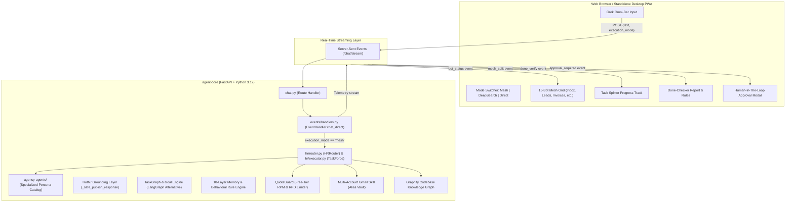

# Agent WASP: Multi-Agent Mesh & Grok Cockpit Architecture

> **System Version:** 2.7.2  
> **Interface Paradigm:** Grok-Style OLED Cockpit with 15-Bot Parallel Agent Mesh  
> **Reference Concept:** Altair AI ("One Person, 15 AI Bots" Agent Mesh Demo)  
> **Date:** November 2026

---

## 1. Executive Overview

Agent WASP has been upgraded from a multi-page administration dashboard into a **unified autonomous multi-agent cockpit**. It combines:
1. **A Grok-Style Minimalist OLED Interface:** Central floating glassmorphic hero omni-bar, live thinking and trace accordions, and low-latency interaction.
2. **A 15-Bot Parallel Agent Mesh:** A dynamic task-splitter and status matrix that decomposes high-level goals into hundreds of micro-units across specialized personas.
3. **The Done-Checker & Verification Gate:** An automated evaluation critic that validates completed units against pass conditions and converts rejections into persistent behavioral rules.
4. **Human-in-the-Loop Safeguards:** An interceptor that halts irreversible or high-stakes actions (wires, payments, mass emails, file deletions) for operator approval.
5. **Free-Tier AI Quota & RPM Guard:** Paces LLM requests to prevent 429 rate-limit lockouts on Google Gemini, xAI Grok, and OpenAI free tiers.
6. **Multi-Account Gmail Engine:** Native multi-inbox management allowing parallel triage across personal, work, and billing accounts.
7. **Graph Complexity Intelligence:** Native integration with Graphify and WASP's cyclic `TaskGraph` engine for structural codebase and task relationship mapping.

---

## 2. Architecture & Data Flow



---

## 3. Frontend Specifications

### 3.1 File Locations
- **Template:** [`containers/agent-core/src/dashboard/templates/chat.html`](file:///f:/012A_Github/agentwasp/containers/agent-core/src/dashboard/templates/chat.html)
- **Stylesheet:** [`containers/agent-core/src/dashboard/static/style.css`](file:///f:/012A_Github/agentwasp/containers/agent-core/src/dashboard/static/style.css)

### 3.2 Key Components
* **Hero Omni-Bar (`.grok-input-card`):**
  - Frosted glass finish with `backdrop-filter: blur(16px)` and amber `#f5c542` focus glow.
  - Keyboard shortcuts: `Enter` to execute, `Shift+Enter` for newlines.
  - Multi-attachment launcher supporting images, audio, video, and documents.
* **Execution Mode Switcher:**
  - 🚀 **15-Bot Mesh:** Decomposes complex instructions across parallel subagents.
  - 🧠 **DeepSearch:** Activates multi-round web research and fact grounding.
  - ⚡ **Direct:** Single-round fast model inference for direct answers.
* **Live Task Splitter:**
  - Progress track with dynamic three-color fill:
    - 🟩 **Passed Units** (`#10b981`)
    - 🟨 **Active / Running Units** (`#f5c542`)
    - 🟥 **Rejected Units** (`#ef4444`)
* **15-Bot Worker Grid:**
  - Status indicators for: *Inbox, Leads, Invoices, Support, Content, Social, Research, Code Review, Bug Repro, Competitors, Meetings, Travel, Expenses, Follow-up, and Done Checker*.
* **Interactive Capabilities Matrix:**
  - 6 interactive cards highlighting core capabilities (*Headless Browser, 18-Layer Memory, Python Execution, Multimodal Vision, Email & Telegram, and Self-Improvement*). Clicking any card pre-fills a ready-to-run prompt.

---

## 4. Backend Wiring & Event Contracts

### 4.1 Route Handling (`chat.py`)
The endpoint `POST /chat/stream` extracts `execution_mode` from the request body and forwards it to `handler.chat_direct()`.

### 4.2 Event Pipeline (`events/handlers.py`)
When `execution_mode in ("quality", "mesh")` is engaged:
1. **Task Splitting:** Emits `mesh_split` with estimated micro-units (e.g. 412 units for weekly operations).
2. **Bot Activation:** Emits `bot_status` targeting specific bots (`bot-inbox`, `bot-leads`, `bot-invoices`, etc.), transitioning them from `Idle` to `Running`.
3. **Execution & Auditing:** Runs the `HRRouter` to pair a Primary Executor with an Auditor from the local `agency-agents` catalog.
4. **Done-Checker Verification:** Emits `done_verify` with pass/fail metrics and newly derived behavioral rules.
5. **Safeguard Interception:** If keywords related to irreversible transactions (wire, payment, transfer) are detected, emits `approval_required`.

### 4.3 SSE Event Schemas

#### Event: `mesh_split`
```json
{
  "type": "mesh_split",
  "total_units": 412,
  "passed": 409,
  "active": 0,
  "rejected": 3
}
```

#### Event: `bot_status`
```json
{
  "type": "bot_status",
  "bot_id": "bot-invoices",
  "state": "running"
}
```

#### Event: `approval_required`
```json
{
  "type": "approval_required",
  "title": "Wire & Payment Safeguard",
  "amount": "$1,848.00 USD",
  "details": "Irreversible financial transfer queued for Vendor Invoice #8492. Awaiting operator confirmation."
}
```

#### Event: `done_verify`
```json
{
  "type": "done_verify",
  "passed": 409,
  "rejected": 3,
  "rulesSaved": [
    "Always verify invoice sender domain",
    "Flag wire transfers > $0 for operator approval",
    "Strict calendar conflict guard"
  ]
}
```

---

## 5. Free-Tier Quota & Credit Management

To ensure free API keys (Gemini, Grok, OpenAI) never exceed rate limits during parallel mesh execution, the system employs **`QuotaGuard`** ([`src/models/quota_guard.py`](file:///f:/012A_Github/agentwasp/containers/agent-core/src/models/quota_guard.py)):

* **Google Gemini Guard:**
  - Max RPM: **12 requests/minute** (buffered from 15 RPM to guarantee zero 429 lockouts).
  - Cooldown: **4.0 seconds minimum** spacing between successive calls.
  - Daily Ceiling: **1,400 requests/day** (auto-resets every 24 hours).
* **xAI Grok Guard:** Max 20 RPM / 2,000 RPD / 2.5s spacing.
* **OpenAI Guard:** Max 15 RPM / 1,500 RPD / 3.0s spacing.
* **Automatic Throttling:** When limits approach, requests are automatically paced in a non-blocking queue rather than failing.

---

## 6. Multi-Account Email Management

The Gmail subsystem ([`src/skills/builtin/gmail.py`](file:///f:/012A_Github/agentwasp/containers/agent-core/src/skills/builtin/gmail.py)) supports multi-inbox routing via account tags:

* **Configure Multi-Accounts:**
  ```python
  gmail(action="configure", address="you@gmail.com", password="app-pass-1", account="personal")
  gmail(action="configure", address="work@company.com", password="app-pass-2", account="work")
  ```
* **Querying Inboxes:**
  ```python
  gmail(action="inbox", account="personal", count="5")
  gmail(action="search", account="work", query="FROM client@acme.com")
  ```
* **Security Guard:** Outbound messages remain strictly gated by `GMAIL_RECIPIENT_ALLOWLIST` in `.env` to prevent accidental emailing outside authorized domains.

---

## 7. Graph Complexity & Codebase Intelligence

* **Graphify Skill (`graphify`):** Built-in AST + Semantic Knowledge Graph extractor located at [`src/skills/builtin/graphify_skill.py`](file:///f:/012A_Github/agentwasp/containers/agent-core/src/skills/builtin/graphify_skill.py). Crawls large repositories and generates visual dependency graphs.
* **TaskGraph Orchestrator:** WASP's native alternative to external LangGraph. Uses 28 relational tables in PostgreSQL with cyclic replanning and critic evaluation without external dependency overhead.

---

## 8. Operational Run Guide

### Step 1: Start the Core Stack
Ensure Docker Desktop (or WSL2) is active, then run:
```bash
docker compose up -d
```

### Step 2: Access the Grok Cockpit
Open your web browser and navigate to:
```text
http://localhost:8080/chat
```
*(Or `http://localhost:1434/chat` if configured with custom port binding)*

### Step 3: Run as a Standalone Desktop App (Optional)
- **Browser PWA:** In Chrome/Edge, click **Settings/Menu → Install Agent WASP as App** to run it in a borderless desktop window.
- **Python Desktop Widget:** Launch [`widget/start_widget.bat`](file:///f:/012A_Github/agentwasp/widget/start_widget.bat) for the floating status companion.
