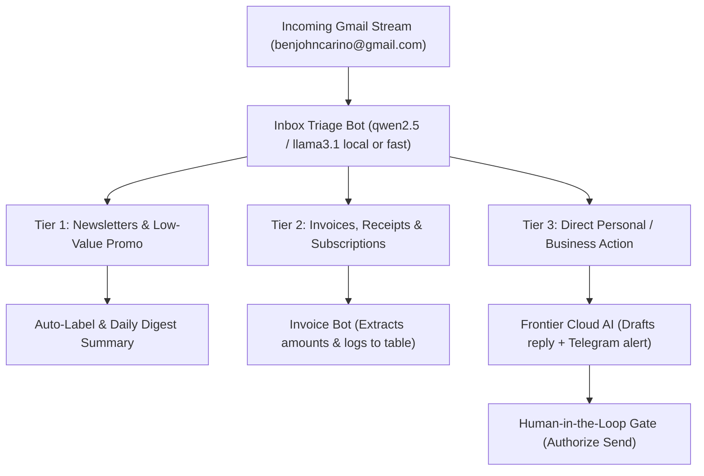

# Strategic Blueprint: Autonomous Email Operations & Governance

> **Account:** `benjohncarino@gmail.com`  
> **Status:** Verified (5,814 messages in Inbox)  
> **Interface:** Grok Cockpit & 15-Bot Mesh Engine  
> **Guardrails:** `GMAIL_RECIPIENT_ALLOWLIST` & Human-in-the-Loop Interceptor

---

## 1. The Core Objective: "Inbox Zero Without Cognitive Overload"

Instead of manually sorting through hundreds of daily newsletters, transactional updates, receipts, and client messages, the agent acts as your **executive digital gatekeeper**.

---

## 2. The 4-Tier Operational Pipeline

### Tier 1: Morning Briefing & Noise Reduction (Daily at 8:00 AM)
* **What the Agent Does:**
  - Scans emails from the last 24 hours.
  - Groups low-priority newsletters, GitHub notifications, and marketing into a single **3-bullet Executive Summary**.
  - Pushes the summary to your dashboard or Telegram.
* **Benefit:** You don't open Gmail just to clear badge counts.

### Tier 2: The Invoice & Expense Scout (Continuous)
* **What the Agent Does:**
  - Queries: `SUBJECT (invoice OR receipt OR bill OR payment OR renewal)`.
  - Downloads PDF receipts/invoices.
  - Uses the sandboxed Python engine to extract: Vendor Name, Date, Invoice #, and Total Amount.
  - Flags upcoming renewal dates so you never get hit by unexpected auto-charges.
* **Safety Gate:** If an invoice requires payment, it creates an approval card and never moves money automatically.

### Tier 3: High-Priority Client / Business Triage
* **What the Agent Does:**
  - Detects messages from real individuals or critical domains.
  - Reads the thread context, extracts the core question/ask, and **pre-drafts a context-aware response**.
  - Presents the draft to you in the Grok Cockpit:
    - *Draft Reply: "Hi John, thanks for reaching out. Yes, we can meet on Thursday at 2 PM..."*
    - *Buttons: `[Edit Draft]` | `[Authorize & Send]` | `[Dismiss]`*.

### Tier 4: Search & Executive Querying on Demand
* **What You Can Ask in the Chat Anytime:**
  - *"Did I get an email from Stripe or my bank yesterday?"*
  - *"Search for flight details or hotel reservations for my upcoming trip."*
  - *"Find all emails regarding contract agreements from last month."*

---

## 3. Recommended Phased Rollout (Zero Risk)

To build complete trust and ensure the agent never behaves unexpectedly, we deploy in 3 safe stages:

1. **Stage 1: Read-Only Triage & Intelligence (Days 1–3)**
   - The agent **only reads and summarizes**. It does not archive, delete, or send anything.
   - It outputs daily summaries and lets you inspect its classification accuracy.
2. **Stage 2: Draft-Assisted Mode (Days 4–7)**
   - The agent drafts suggested responses for your review.
   - You click "Send" yourself or approve it via the cockpit button.
3. **Stage 3: Full Autonomous Filter & Safeguarded Sending (Week 2+)**
   - Automatically sorts transactional receipts and notifies you only when an action is truly required.
