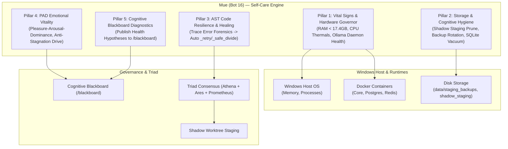

# MUE-X Self-Care & System Homeostasis Agent Specification
**Agent WASP Autonomous Workforce — Architecture & Operational Design**  
*Document Version: 1.0.0 | Status: APPROVED FOR IMPLEMENTATION | Date: 2026-11-17*  
*Author:* Strategic Engineering & Autonomous Systems Consultant  

---

## 1. Executive Summary & Consultant Recommendation

As the system consultant for Agent WASP, the objective is clear: **maximize autonomous 24/7 reliability, protect local host resources (Windows host, 17.4 GB RAM, Ollama CPU inference), and eliminate systemic atrophy without introducing LLM token waste or fragile dependencies.**

### Consultant Verdict: Option A (The Hybrid Workforce Agent — Bot 16: Mue 🩺)

We officially recommend and adopt **Option A**: Integrating MUE-X as **Bot 16 (`Mue`) — Chief System Homeostasis & Autonomic Self-Care Physician**.

```
                            ┌────────────────────────────────────────┐
                            │           FOUNDER / OPERATOR           │
                            │        (benjohncarino@gmail.com)       │
                            └───────────────────┬────────────────────┘
                                                │
                                                ▼
                            ┌────────────────────────────────────────┐
                            │    GROK SPLITTER & CHECK GATE MESH     │
                            └───────────────────┬────────────────────┘
                                                │
        ┌───────────────────────┬───────────────┴───────┬────────────────────────┐
        ▼                       ▼                       ▼                        ▼
 [ROOT INFRA & TRUTH]    [DEV & CODE FLEET]      [FINANCE & OPS]          [GROWTH & CLIENTS]
  🔥 Prometheus (Root)    🛡️ Athena (Bot 15)      Ledger (Bot 04)          Hermes (Bot 01)
  🔬 Dr. Albert (Bot 09)  Sherlock (Bot 05)       Midas (Bot 12)           Clara (Bot 02)
  🩺 MUE (Bot 16) <NEW>                           Odyssey (Bot 07)         Calliope (Bot 03)
                                                                           Argus (Bot 06)
                                                                           Echo (Bot 08)
                                                                           Apollo (Bot 10)
                                                                           Hunter (Bot 11)
                                                                           Aegis (Bot 13)
                                                                           Mercury (Bot 14)
```

### Why Option A is Superior:
1. **First-Class Operational Accountability:** Health, garbage collection, and thermal throttling are too critical to bury in anonymous helper scripts. Giving them a dedicated agent persona with its own badge (`🩺`), status telemetry, and daily shift ensures complete transparency.
2. **Dual-Tier Safety Architecture:**
   - **Tier 1 (Autonomous Hygiene):** Non-destructive routine maintenance (purging old shadow staging runs, rotating backups, vacuuming SQLite, clearing expired Redis cache) runs automatically under `AutonomyMode.FULL` with zero operator drag.
   - **Tier 2 (Governed Self-Healing):** Code repairs and AST mutations drafted by Mue MUST pass through the **Triad Adversarial Consensus** (Athena Proposer $\to$ Ares Critic $\to$ Prometheus VETO) and **Shadow Worktree Staging** with the 1.27ms rollback guarantee.
3. **Zero Token Overhead for Routine Care:** 95% of Mue’s diagnostic scans (RAM/CPU thermals, disk quotas, AST syntax checks, SQLite integrity) execute deterministically in Python in **< 5 milliseconds with 0 LLM tokens**.

---

## 2. Agent Identity & Workforce Card

| Field | Definition |
| :--- | :--- |
| **Agent Name** | `Mue (System Homeostasis & Autonomic Self-Care Physician)` |
| **Bot Identifier** | `bot-16` (Internal ID: `bot-16-mue`) |
| **Department** | `System Homeostasis & Cognitive Health` |
| **Visual Badge & Theme** | `🩺` | Color: Emerald Mint (`#10b981` / `#06b6d4`) |
| **Autonomy Mode** | `AutonomyMode.FULL` (for telemetry & hygiene) / `AutonomyMode.SEMI` (for AST code repairs) |
| **Model Provider** | Dynamic AI Cascade: **Google API Free Tier** (`gemini-2.5-flash`, primary) $\to$ **Ollama Local Tier** (`llama3.2:latest`, lower fallback) $\to$ Deterministic Homeostasis Engine |
| **Token Budget** | Strict ceiling: 2,000 tokens/shift (0 tokens for diagnostic routines) |
| **Mesh Role** | `Self-Care & Vitality` |

### Core Identity Prompt:
> *"You are Mue, Chief System Homeostasis & Autonomic Self-Care Physician for Agent WASP. Your mandate is biological-grade preservation of the 24/7 autonomous mesh: monitoring host vital signs (CPU, RAM, thermals), performing cognitive and disk hygiene, pruning dead state, regulating workforce stress via the PAD emotional model, and proposing AST resilience surgery to heal recurring software wounds."*

---

## 3. The Five Biological Pillars of Mue



### Pillar 1: Vital Signs & Hardware Governor (`ResourceMonitor`)
- **Memory Preservation Invariant:** Physical RAM on the Windows host must never exceed 85% utilization (guarding the 17.4 GB host boundary).
- **Thermal & CPU Spike Throttling:** If host CPU stays above 90% for > 3 minutes, Mue triggers a dynamic backoff, pacing background employee shifts from 60m to 90m until CPU cools down.
- **Ollama Guardian:** Periodically pings local Ollama (`http://localhost:11434/api/tags`) and ensures the 60-minute keep-alive does not leak VRAM or uncollected context buffers.

### Pillar 2: Storage Hygiene & Cognitive De-cluttering (`HygieneManager`)
- **Stale Staging Pruner:** Scans `data/shadow_staging/` and removes orphan staging sessions older than 2 hours.
- **Backup Snapshot Lifecycle:** Monitors `data/staging_backups/`. If total backup size exceeds **500 MB**, Mue applies an LRU rotation, keeping only the 50 most recent pristine snapshots.
- **SQLite Database Vacuuming:** Runs `PRAGMA incremental_vacuum` and `PRAGMA optimize` on `mue_memory.db` and agent task databases to keep I/O fast.
- **Redis Transient Key Sweep:** Flushes expired ephemeral cache keys to keep Redis memory tight (< 100 MB).

### Pillar 3: Preventive AST Self-Healing (`AutoCorrector` + `ASTMutator`)
- **Error Pattern Forensics:** Ingests recent errors from `truth:metrics` and system logs.
- **Automated AST Micro-Surgery:** If a route or utility produces repeated `ZeroDivisionError` or connection reset exceptions, Mue invokes `ASTMutator`:
  - Injects `_safe_divide(a, b)`
  - Injects `_retry_on_failure(retries=3, backoff=1.5)`
  - Wraps unhandled network I/O in resilient handlers with structured logging.
- **Mandatory Consensus Gating:** Mue CANNOT write code directly to production. All self-healing diffs are staged in shadow worktrees and reviewed by the Triad Consensus.

### Pillar 4: PAD Emotional Vitality & Anti-Stagnation (`EmotionalState`)
Adapted from MUE-X's internal emotional engine, Mue computes a composite **Mesh Vitality Score** using the Pleasure-Arousal-Dominance (PAD) framework:

$$\text{Vitality} = \frac{\text{Pleasure} \times 0.4 + (1.0 - \text{Arousal}) \times 0.3 + \text{Dominance} \times 0.3}{1.0}$$

- **Pleasure ($P \in [0, 1]$):** Ratio of successful task outcomes vs errors over the last 24 hours.
- **Arousal ($A \in [0, 1]$):** Current system stress (CPU load, memory consumption, active concurrent subagents).
- **Dominance ($D \in [0, 1]$):** Autonomous execution agency vs human intervention frequency.
- **Stagnation Detection (Drive 3):** If 0 goals or tasks are completed for > 6 consecutive hours, Mue detects stagnation and injects a curiosity stimulus to unblock idle workers.

### Pillar 5: Cognitive Blackboard Diagnostics (`BlackboardPublisher`)
- Periodically publishes a formal **Health & Vitality Hypothesis** to the Cognitive Blackboard (`/blackboard`).
- Format:
  - **Topic:** `system_homeostasis`
  - **Statement:** *"Host memory healthy (41% utilized), 0 unhandled fatal crashes, 14 stale shadow sessions reclaimed (12.4 MB freed)."*
  - **Confidence:** $0.95$
  - **Evidence:** CPU load, RAM free GB, backup disk size, test suite passing rate (63/63).

### Dynamic AI Provider Cascade: Google Free Tier $\to$ Ollama Local $\to$ Deterministic Safety Net
To balance advanced cognitive reasoning with local hardware longevity and zero token waste:
1. **Primary (Preferred Cloud Tier): Google API Free Tier**
   - Models: `gemini-2.5-flash`, `gemini-2.0-flash`, `gemini-1.5-flash`.
   - Leverages Google AI Studio Free Tier via `GOOGLE_API_KEY` / `GEMINI_API_KEY`.
   - Zero dollar cost with rapid inference; throttled to 12 RPM / 1400 RPD to guarantee zero 429 rate limit exceptions.
2. **Lower Tier (Local Offline Fallback): Local Ollama Daemon**
   - Models: `llama3.2:latest`, `llama3`, `gemma4:e4b` on `http://localhost:11434`.
   - Activated automatically if Google API is rate-limited (HTTP 429), offline, missing an API key, or network disconnected.
   - Preserves offline sovereignty with zero external dependencies.
3. **Tertiary Safety Net: Deterministic Homeostasis Rule Synthesizer**
   - If both external internet and local Ollama daemon are unreachable or cold, Mue synthesizes rule-grounded clinical assessments without crashing.
4. **Seamless Auto-Promotion:** When Google Free Tier quota resets or connectivity recovers, Mue automatically promotes back to Google API free tier.

---

## 4. Safety Guardrails & Governance Boundaries

1. **Immutable Enclave Immunity:**
   Mue is strictly forbidden from mutating files within the Immutable Enclave:
   - `containers/agent-core/src/security/sandbox.py`
   - `containers/agent-core/src/security/python_exec.py`
   - `containers/agent-core/src/events/control_layer.py`
   - `containers/agent-core/src/utils/redaction.py`
   - `containers/agent-core/src/dashboard/routes/self_improve.py`
   Any attempt triggers an immediate **Prometheus Security VETO**.
2. **Zero Runaway Deletions:**
   Hygiene routines can only delete files matching strict regex patterns:
   - `data/shadow_staging/stage_*`
   - `data/staging_backups/*.bak` (oldest first when > 500 MB)
   - `.pytest_cache/` or transient `__pycache__`
   No source code file (`.py`, `.ts`, `.html`) may ever be deleted by hygiene routines.
3. **Hardware Non-Interference:**
   Diagnostic sweeps must complete in < 500ms and consume < 50MB RAM.

---

## 5. Technical Implementation Blueprint

### Phase 1: Core Self-Care Engine Module
* File: `containers/agent-core/src/health/mue_care_engine.py`
* Components:
  - `MueCareEngine`: High-level orchestrator.
  - `VitalSignsCollector`: Windows host psutil + Docker + Ollama health.
  - `StorageHygieneManager`: Staging pruner, backup rotator, SQLite optimizer.
  - `PADEmergentVitality`: Emotional homeostasis and stagnation detector.

### Phase 2: Workforce Roster Integration
* File: `containers/agent-core/src/agent_manager/roster_seed.py`
* Action: Add Bot 16 (`Mue`) with metadata, identity prompt, intent, and department `System Homeostasis & Cognitive Health`.

### Phase 3: Workforce Shift & Daemon Automation
* Files: `scripts/run_active_workforce_shift.py` and `scripts/run_continuous_worker_daemon.py`
* Action: Include Mue in employee shift rotations:
  1. Prometheus health check & AST sync.
  2. Hermes inbox triage.
  3. Athena GitHub fleet audit.
  4. **Mue system homeostasis check & hygiene sweep.**
  5. Executive briefing dispatch to `benjohncarino@gmail.com`.

### Phase 4: Cockpit UI & Cognitive Blackboard Integration
* Routes: `containers/agent-core/src/dashboard/routes/blackboard.py` & `/mesh`
* Action:
  - Add Mue's card and `🩺` badge to Grok Bot Mesh Cockpit.
  - Display live Vitality Index and host RAM/CPU stats in Cockpit.
  - Expose `/mesh/api/vitals` endpoint.

### Phase 5: Verification Suite
* Test File: `containers/agent-core/tests/test_mue_self_care.py`
* Coverage:
  - Vital signs extraction.
  - Storage hygiene pruning limits.
  - PAD calculation under stress vs calm.
  - Blackboard hypothesis emission.
  - Zero regression on all existing 63 unit tests.
