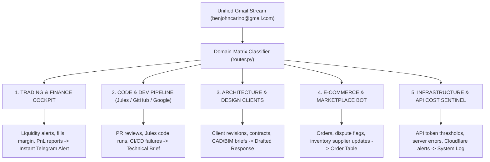

# High-Leverage Operator Blueprint: Domain-Matrix Email Cockpit

> **Operator Profile:** Architect & Designer • Full-Stack / AI Engineer (Jules Google Coding) • High-Frequency & Algorithmic Trader • Digital E-Commerce & Online Marketplace Operator  
> **Engine:** Agent WASP 15-Bot Mesh + DeepSearch + Real-Time IMAP/SSL  
> **Account:** `benjohncarino@gmail.com`

---

## 1. The Architectural Shift: Matrix Routing

As a multi-disciplinary operator, a standard "inbox unread" list is counterproductive. Your emails represent **5 distinct, high-stakes operational domains**. 

Instead of a generic inbox feed, WASP partitions incoming communication into a **5-Channel Signal Matrix**:

---

## 2. The 5 Operational Channels Defined

### Channel 1: Trading & Market Execution Sentinel (High Urgency)
* **Target Signals:** Binance, Bybit, HTX, Interactive Brokers, TradingView webhooks, funding rate notifications, margin calls, liquidation warnings, bank deposit/wire confirmations.
* **Autonomous Behavior:**
  - Extracts timestamp, instrument (pair/ticker), order type, price, and executed volume.
  - If a **margin warning** or **failed fill** is detected, it bypasses email digestion and immediately pushes a **High-Priority Telegram ping** to your phone with exact figures.
  - Daily at market close: consolidates exchange trade fees and execution summaries into a clean PnL table.

### Channel 2: Jules / Google & AI Dev Operations
* **Target Signals:** Google Cloud / Jules coding agent notifications, GitHub PR reviews, issue assignments, CI/CD build fails, Docker hub alerts, Hugging Face model hub updates.
* **Autonomous Behavior:**
  - Extracts failing build logs or Jules coding progress summaries.
  - Automatically correlates repo names against your local workspaces (`012A_Github`).
  - Summarizes PR comments and generates a one-click prompt ready for the Grok Cockpit:  
    `"Jules completed PR #12 on agentwasp. Review diff and run tests."`

### Channel 3: Architecture & Design Studio
* **Target Signals:** Client inquiries, RFP tenders, structural engineer revisions, contractor RFI (Request For Information), permit approvals, CAD/3D asset delivery.
* **Autonomous Behavior:**
  - Separates high-value client communication from vendor marketing.
  - Flags project milestones and deadline changes.
  - Pre-drafts professional, context-grounded responses acknowledging receipt and quoting project timeline estimates for your 1-click authorization.

### Channel 4: Online Business & E-Commerce / Marketplace
* **Target Signals:** Stripe/PayPal payouts, customer order notifications, supplier inventory stock alerts, customer support inquiries, dispute or chargeback warnings.
* **Autonomous Behavior:**
  - **Chargeback / Dispute Guard:** Pings you immediately with transaction history if a dispute or customer complaint arrives.
  - **Daily Commerce Tally:** Generates a daily gross revenue, pending shipping orders, and net payout summary.

### Channel 5: SaaS & API Infrastructure Watchdog
* **Target Signals:** OpenAI, Gemini, Anthropic, Supabase, Neon, Render, Cloudflare billing and usage alerts.
* **Autonomous Behavior:**
  - Catches quota threshold alerts (e.g. "80% of monthly tier reached") before unexpected service disruption occurs.
  - Flags unexpected recurring subscription renewals 48 hours in advance.

---

## 3. Daily Execution Schedule

| Time | Operation | Delivery Channel |
| :--- | :--- | :--- |
| **07:30 AM** | **Executive Briefing:** Overnight Trading fills + E-commerce revenue + Today's critical client/code priorities. | Telegram & Grok Cockpit |
| **Real-Time** | **Emergency Interrupts:** Margin alerts, wire transfers > $0, customer disputes, build breaks. | High-Priority Notification + Action Card |
| **06:00 PM** | **Daily Close & Reconcile:** Invoices logged to database, pending client drafts awaiting review, tomorrow's meeting briefs. | Dashboard Review Panel |
| **01:00 AM** | **Dream Cycle Memory Consolidate:** Extracts client names, project specs, and transaction facts into the Knowledge Graph. | Background Automated |

---

## 5. Security & Threat Sentinel: Anti-Spam, Scams & Malicious Link Detection

To protect your trading balances, private keys, e-commerce revenues, and personal credentials, an autonomous **Email Threat Sentinel** (`src/skills/builtin/email_threat_sentinel.py`) inspects incoming messages across 4 rigorous threat vectors:

### Vector 1: Malicious & Phishing Links (Flagged Immediately)
The agent parses every embedded hyperlink in the email body and flags:
* **Raw IP Addresses in URLs:** Links pointing directly to numeric hosts (e.g. `http://192.168.1.1/login` or `http://45.33.32.156/auth`) instead of legitimate domain names.
* **Obfuscated URL Shorteners:** Links using `bit.ly`, `tinyurl.com`, `t.co`, `cutt.ly`, or `is.gd` designed to hide the true destination URL.
* **Punycode / Homoglyph Attacks:** Domains containing `xn--` or Cyrillic lookalike characters (e.g. using a Cyrillic 'a' to spoof `binance.com` or `google.com`).

### Vector 2: Sender Spoofing & Domain Mismatches
* **Display Name Impersonation:** Detects when an email display name says `"Binance Security"`, `"Stripe Support"`, `"PayPal Billing"`, or `"MetaMask Team"`, but the actual sender domain is an unrelated address (e.g. `@binance-verify-auth.xyz` or `@gmail.com`).
* **Return-Path Discrepancies:** Flags when the envelope sender does not match SPF/DKIM authenticated domain records.

### Vector 3: Psychological Urgency & Scam Heuristics
High-pressure social engineering triggers are assigned threat points:
* *"Account suspended within 24 hours"*
* *"Immediate action required or funds will be locked"*
* *"Confirm your seed phrase / private key / wallet validation"*
* *"Unauthorized wire transfer detected — click here to reverse"*
* Crypto airdrop claims, fake inheritance, or unexpected prize notifications.

### Vector 4: Dangerous Payload Attachments
Attachments with executable or script extensions are flagged with **CRITICAL DANGER** and never opened or previewed:
* `.exe`, `.scr`, `.bat`, `.cmd`, `.vbs`, `.js`, `.wsf`, `.iso`, `.img`, `.hta`, `.ps1`, `.xlsm` (macro-enabled spreadsheets).

---

### Threat Scoring & Automatic Quarantine Matrix

| Score Range | Verdict | Action Taken by WASP |
| :---: | :---: | :--- |
| **0 – 19** | **CLEAN** | Processed through standard 5-Channel Operator Matrix. |
| **20 – 49** | **SUSPICIOUS** | Flagged with yellow warning banner in dashboard; links neutralized into non-clickable text. |
| **50 – 100** | **DANGEROUS / SCAM** | **Quarantined.** Suppressed from your morning briefing; high-risk alert pushed to Telegram warning of active attack. |
