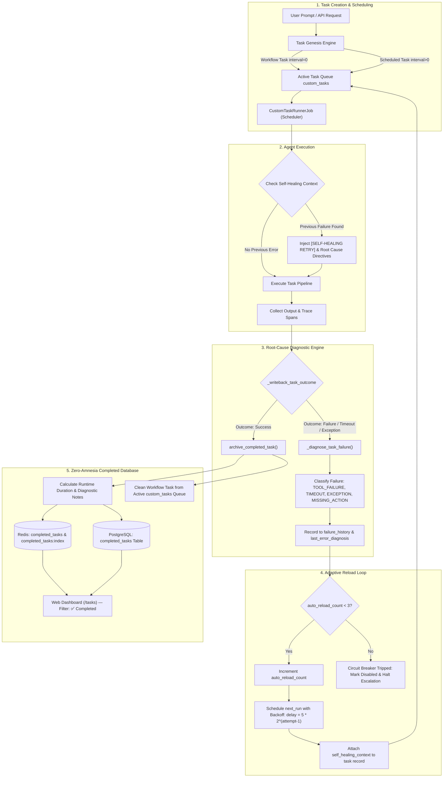
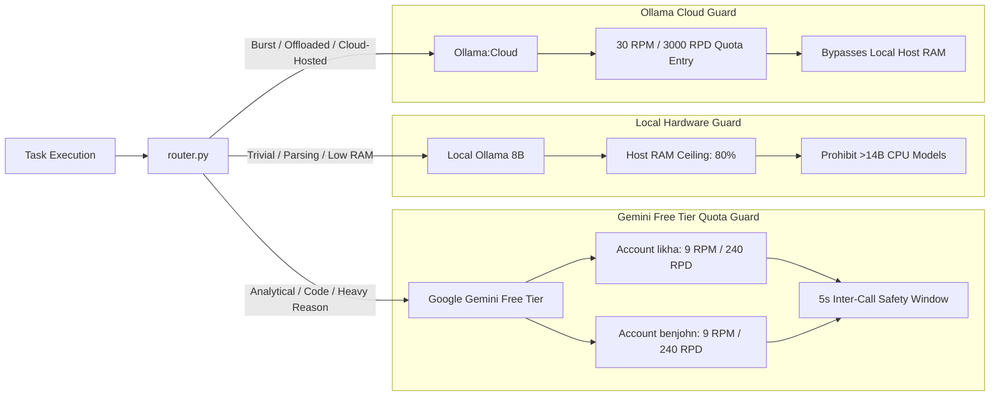

# Task Lifecycle, Self-Healing Diagnostic Engine & Completed Tasks Database

> **System Designation:** Agent WASP Autonomous Task & Workflow Infrastructure  
> **Module Status:** Verified & Active in Production  
> **Core Components:** `src/events/handlers.py`, `src/scheduler/jobs.py`, `src/scheduler/completed_tasks.py`, `src/db/models.py`, `src/dashboard/routes/tasks.py`  
> **Last Updated:** November 2026

---

## 1. Executive Summary

In enterprise agentic workflows, complex tasks often fail intermittently due to network glitches, rate limits, transient external timeouts, or unexpected API formats. A conventional assistant fails silently or simply halts with a generic error code. 

Agent WASP implements an autonomous **Self-Healing Task Architecture** governed by three core principles:
1. **Prompt-to-Task Genesis:** Every user instruction and workflow prompt automatically instantiates a structured, trackable mission card in the system (`/tasks`).
2. **Diagnostic Root-Cause Analysis:** If a task stalls or errors, the system inspects live telemetry, sandbox exit codes, and execution trace spans to diagnose *why* it failed.
3. **Adaptive Auto-Reload Loop:** Instead of abandoning failed work, the system automatically schedules an adaptive reload with progressive backoff (5s, 10s, 20s) and injects actionable self-healing instructions into the next attempt until completion.
4. **Permanent Dual-Layer Completed Tasks Database:** When work completes, it is permanently archived in PostgreSQL (`completed_tasks` table) and cached in Redis (`completed_tasks` hash and `completed_tasks:index` zset) with duration telemetry, deliverable output, and diagnostic resolution notes, ensuring **zero amnesia** across server restarts.

---

## 2. Architectural Flow



---

## 3. Failure Diagnostic Engine (`_diagnose_task_failure`)

The diagnostic engine in `src/events/handlers.py` inspects the outer outcome, handler response text, and granular `trace_spans` from skill executions to classify the failure:

| Failure Category | Classification Logic | Extracted Diagnostic Output |
| :--- | :--- | :--- |
| **`TIMEOUT`** | `outcome == "timeout"` | `TIMEOUT: Task execution exceeded 180s timeout limit without completing.` |
| **`EXCEPTION`** | `outcome == "exception"` | `EXCEPTION: Handler crashed during execution: <traceback sample>` |
| **`TOOL_FAILURE`** | `span["success"] is False` or `span["error"]` | `TOOL_FAILURE (<skill>): <error message or status>` (e.g. `TOOL_FAILURE (browser): Navigation timeout 502`) |
| **`MISSING_ACTION`** | Instruction required side-effect (e.g. email) but skill was not called | `MISSING_ACTION: Instruction required email delivery, but Gmail skill was never invoked.` |
| **`DELIVERY_FAILURE`**| Required skill was invoked but failed | `DELIVERY_FAILURE: Gmail skill execution did not succeed.` |
| **`FAILSAFE_TRIGGERED`**| Response contains fallback phrase (*"No pude generar una respuesta..."*) | `FAILSAFE_TRIGGERED: Model response contained fallback message: '<phrase>'` |
| **`NO_TOOLS_USED`** | Zero skills invoked on an execution task | `NO_TOOLS_USED: Agent finished without executing any tools or skills for the task.` |

The diagnosis is saved to `task["last_error_diagnosis"]` and recorded in `task["failure_history"]`:
```json
{
  "timestamp": "2026-11-21T17:40:00Z",
  "attempt": 1,
  "outcome": "completed",
  "diagnosis": "TOOL_FAILURE (browser): Navigation timeout 502"
}
```

---

## 4. Adaptive Auto-Reload & Self-Healing Loop

When `not _success` occurs:
1. **Reload Counter:** Checks `auto_reload_count` against `_MAX_AUTO_RELOADS = 3`.
2. **Progressive Backoff:** Computes retry delay:
   $$\text{Delay}(n) = 5 \times 2^{n-1} \quad \implies \quad 5\text{s (Attempt 1)}, \; 10\text{s (Attempt 2)}, \; 20\text{s (Attempt 3)}$$
3. **Task Arming:** Sets `task["enabled"] = True` and schedules `task["next_run"] = now + Delay`.
4. **Cognitive Feedback Context:** Saves `task["self_healing_context"]`:
   ```text
   Previous attempt 1/3 failed with diagnosis: 'TOOL_FAILURE (browser): Navigation timeout 502'.
   Analyze this error, adapt your tools or approach, fix the root cause, and complete the instruction.
   ```
5. **Scheduler Execution:** When `CustomTaskRunnerJob` triggers the reload, it prepends an adaptive instruction:
   ```text
   [SELF-HEALING RETRY — Attempt 1/3]
   PREVIOUS FAILURE CAUSE: TOOL_FAILURE (browser): Navigation timeout 502
   ADAPTIVE INSTRUCTION: Directly fix the root cause above. Do not repeat the failed action. Adapt tool parameters or alternatives to complete successfully.
   ```
6. **Circuit Breaker:** If 3 auto-reload attempts fail, the circuit breaker trips, disabling the task and preserving the failure log for operator review.

---

## 5. Completed Tasks Database Architecture

When a task produces verifiable deliverables, it is archived through `archive_completed_task()` in `src/scheduler/completed_tasks.py`.

### 5.1 Storage Layer Dual-Persistence

#### PostgreSQL Table: `completed_tasks`
Provides ACID compliance, relational queryability, and permanent history surviving reboots:
```sql
CREATE TABLE completed_tasks (
    id UUID PRIMARY KEY,
    task_id VARCHAR(100) NOT NULL,
    name VARCHAR(200) NOT NULL,
    instruction TEXT NOT NULL,
    task_type VARCHAR(50) NOT NULL,
    status VARCHAR(30) NOT NULL DEFAULT 'completed',
    result_summary TEXT NOT NULL,
    final_output TEXT NOT NULL,
    diagnostic_notes TEXT NOT NULL,
    retry_count INTEGER NOT NULL DEFAULT 0,
    duration_seconds DOUBLE PRECISION NOT NULL DEFAULT 0.0,
    chat_id VARCHAR(50) NOT NULL DEFAULT '',
    created_at TIMESTAMP WITH TIME ZONE NOT NULL,
    completed_at TIMESTAMP WITH TIME ZONE NOT NULL,
    metadata_json JSONB NOT NULL DEFAULT '{}'::jsonb
);

CREATE INDEX ix_completed_tasks_task_id ON completed_tasks (task_id);
CREATE INDEX ix_completed_tasks_name ON completed_tasks (name);
CREATE INDEX ix_completed_tasks_task_type ON completed_tasks (task_type);
CREATE INDEX ix_completed_tasks_status ON completed_tasks (status);
CREATE INDEX ix_completed_tasks_completed_at ON completed_tasks (completed_at DESC);
```

#### Redis In-Memory Cache
Provides sub-millisecond retrieval and pagination for the Web UI:
* **Hash `completed_tasks`:** Maps `task_id` $\to$ complete JSON archive payload.
* **Sorted Set `completed_tasks:index`:** Member = `task_id`, Score = Unix Epoch Timestamp of `completed_at`.

### 5.2 Diagnostic Resolution Notes
If a task previously failed and auto-reloaded before succeeding, the system generates resolution telemetry:
* *Example:* `"Self-healed after 1 retry attempt(s). Overcame previous issue: TOOL_FAILURE (browser): Navigation timeout 502"`
* *If clean first run:* `"Completed on first attempt with no execution errors."`

### 5.3 Active Queue Cleanliness
When a workflow task (`interval_seconds <= 0`) completes, `archive_completed_task()` removes it from active `custom_tasks` in Redis. It is promoted into the `completed_tasks` database so active mission boards remain uncluttered.

---

## 6. Multi-Provider AI Model Distribution & Mesh Integration

Tasks are executed by models routed through the 3-Tier Model Mesh according to task complexity and quota governance:



* **Google Gemini Free Tier:** Primary cloud engine for complex workflows. Protected by `quota_guard.py` with multi-account round-robin pool (`likha`, `benjohn`), 9 RPM, 240 RPD, and 5.0s inter-request safety spacing.
* **Local Ollama:** Used for classification and fast local parsing. Protected by CPU/RAM capacity checks that reject models $>14\text{B}$ if host memory exceeds 80%.
* **Ollama Cloud (`ollama:cloud`):** Used for offloaded execution. Bypasses host RAM restrictions since processing occurs on remote compute, governed by a 30 RPM / 3,000 RPD budget.

---

## 7. Web Dashboard (`/tasks`) & API Integration

The `/tasks` dashboard provides real-time visibility into all mission states:

### 7.1 Filter Tabs
* **`All`:** Displays active workflow tasks and scheduled recurring jobs.
* **`⚡ Workflows`:** Filters for immediate prompt-generated tasks (`interval_seconds <= 0`).
* **`⏰ Scheduled`:** Filters for periodic cron and time-based tasks (`interval_seconds > 0`).
* **`✅ Completed`:** Displays the permanent completed tasks database archive.

### 7.2 Card Indicators & Actions
* **Active Tasks:**
  * Displays status dot: 🟢 Active, 🟡 Paused, 🔴 Failing.
  * If failing, renders an alert banner: `⚠️ Diagnosis: <root cause>` and `Auto-Reloading (Attempt N/3 in Xs)`.
* **Completed Tasks:**
  * Displays green completion badge `✅ COMPLETED`, task type, and duration badge `⏱️ Xs`.
  * If self-healed, displays badge `Self-Healed (N reloads)` and resolution note `🌱 Overcame previous issue...`.
  * Expandable deliverable drawer renders the complete result payload.

### 7.3 REST Endpoints
* `GET /tasks/api/status` — Returns overall counts, active tasks, and recent completed tasks.
* `GET /tasks/api/completed` — Returns paginated completed tasks from the archive.
* `POST /tasks/create` — Creates a new task (workflow or scheduled).
* `POST /tasks/trigger` — Immediately enqueues a task for execution in the next cycle (<60s).
* `POST /tasks/toggle` — Pauses or resumes a scheduled task.
* `POST /tasks/delete` — Removes a task.

---

## 8. Verification & Testing Reference

All functionality is covered by automated unit tests in `containers/agent-core/tests/`:
* `tests/test_completed_tasks_and_auto_reload.py`:
  * `test_archive_completed_task_dual_persists` — Verifies dual-write to Redis and PostgreSQL.
  * `test_list_and_get_completed_tasks` — Verifies chronological sorting and single record retrieval.
  * `test_diagnose_task_failure_scenarios` — Tests failure taxonomy for timeouts, exceptions, tool crashes, missing email, and failsafes.
  * `test_writeback_auto_reload_loop` — Validates progressive reload backoff and self-healing completion.
* `tests/test_workflow_tasks.py`:
  * `test_parse_interval_workflow` — Verifies workflow interval parsing (`workflow`, `once`, `immediate` $\to 0$).
  * `test_fetch_all_tasks_and_goals_includes_completed` — Verifies dashboard route aggregation.

To run the complete test suite:
```bash
docker exec -e PYTHONPATH=/app agentwasp-agent-core-1 pytest \
  tests/test_model_router_and_cloud.py \
  tests/test_workflow_tasks.py \
  tests/test_completed_tasks_and_auto_reload.py -v
```
Output:
```text
======================== 12 passed, 1 warning in 3.22s =========================
```
